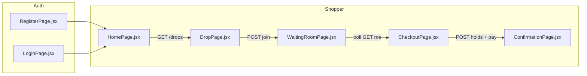

# Dropgate web app — end-to-end flow

This document explains how the React frontend works: which **files** run, which **URLs** you visit, and which **API calls** happen. All paths below are under `app/web/` unless noted.

---

## 1. How the app boots

```
index.html
  → src/main.jsx
       wraps everything in AuthProvider (src/auth/AuthContext.jsx)
       renders App (src/App.jsx)
  → src/App.jsx
       BrowserRouter + route table → picks a page component
```

| File | Role |
|------|------|
| `src/main.jsx` | Entry point; mounts React on `#root` |
| `src/auth/AuthContext.jsx` | Global login state: `user`, `token`, `loading`, `login`, `register`, `logout` |
| `src/api/client.js` | Every API call goes through `apiFetch()` → `VITE_API_URL` + `/api/v1/...` |
| `src/App.jsx` | **Route map** — URL path → page file |
| `src/components/RequireAuth.jsx` | Blocks pages if not logged in or wrong role (`shopper` vs `merchant`) |
| `src/components/Layout.jsx` | Shared header (brand, email, logout) |
| `src/index.css` + `src/App.css` | Dark “launch” styling |

**Session:** JWT is stored in `localStorage` under key `token`. On load, `AuthContext` calls `GET /auth/me` to restore the user.

---

## 2. Route map (URL → file)

Defined in **`src/App.jsx`**.

| URL | File | Who can open it |
|-----|------|-----------------|
| `/login` | `src/pages/LoginPage.jsx` | Public |
| `/register` | `src/pages/RegisterPage.jsx` | Public |
| `/` | `src/pages/HomePage.jsx` | Shopper only (`RequireAuth role="shopper"`) |
| `/drops/:slug` | `src/pages/DropPage.jsx` | Shopper |
| `/drops/:slug/waiting` | `src/pages/WaitingRoomPage.jsx` | Shopper |
| `/drops/:slug/checkout` | `src/pages/CheckoutPage.jsx` | Shopper |
| `/orders/success` | `src/pages/ConfirmationPage.jsx` | Shopper |
| `/merchant` | `src/pages/MerchantDashboardPage.jsx` | Merchant only |
| `/merchant/drops/new` | `src/pages/MerchantCreateDropPage.jsx` | Merchant |
| `/merchant/drops/:id` | `src/pages/MerchantDropPage.jsx` | Merchant (control room) |

If a shopper hits `/merchant`, or a merchant hits `/` without logging in as shopper, **`RequireAuth`** shows “Not allowed” or redirects to `/login`.

---

## 3. Merchant flow (Browser A)

Goal: create a drop, schedule it, go live so shoppers can queue.

```
/register (role: merchant)
  → RegisterPage.jsx → POST /auth/register → token saved → redirect /merchant

/merchant
  → MerchantDashboardPage.jsx → link to create

/merchant/drops/new
  → MerchantCreateDropPage.jsx
  → POST /drops { name, slug, sku, times, ... }
  → redirect /merchant/drops/:id

/merchant/drops/:id  (control room)
  → MerchantDropPage.jsx
  → GET /drops/:id/admin (poll every 3s)
  → [Schedule]  POST /drops/:id/schedule   (draft → scheduled)
  → [Go live]   POST /drops/:id/go-live      (scheduled → live, admits first batch)
```

**Important:** Shoppers only see drops on home when status is `scheduled`, `live`, or `sold_out` (`GET /drops`). A **draft** drop does not appear on shopper home until you **Schedule** (and it will list as scheduled; join rules still apply once registration is open).

---

## 4. Shopper flow (Browsers B, C, D)

Goal: join queue → wait → checkout → pay → confirmation.

### Step A — Account

```
/register or /login
  → RegisterPage.jsx / LoginPage.jsx
  → POST /auth/register or POST /auth/login
  → shopper → redirect /
  → merchant → redirect /merchant
```

### Step B — Pick a drop

```
/
  → HomePage.jsx
  → GET /drops (no auth)
  → cards link to /drops/:slug
```

### Step C — Drop detail + join

```
/drops/:slug
  → DropPage.jsx
  → GET /drops/slug/:slug
  → if already in queue: GET /drops/:id/waiting-room/me → auto redirect /drops/:slug/waiting
  → [Join queue] POST /drops/:id/waiting-room
  → navigate /drops/:slug/waiting
```

Uses **`drop.id`** from the GET response for join (not the slug in the URL).

### Step D — Waiting room (polling)

```
/drops/:slug/waiting
  → WaitingRoomPage.jsx
  → GET /drops/slug/:slug once (resolve dropId + name)
  → every 2s: GET /drops/:dropId/waiting-room/me
  → shows aheadCount + status: queued | admitted | purchased
  → when admitted: [Continue to checkout] → /drops/:slug/checkout
```

Uses **`src/components/StatusBadge.jsx`** for status pills.

### Step E — Checkout

```
/drops/:slug/checkout
  → CheckoutPage.jsx
  → GET /drops/slug/:slug + GET waiting-room/me
  → if not admitted → redirect back to waiting room
  → [Reserve] POST /holds { skuId, qty: 1 } (+ Idempotency-Key)
  → Countdown.jsx uses hold.expiresAt (also GET /holds/:id on expire)
  → [Pay success] POST /holds/:id/pay { result: "success" }
  → [Pay fail]    POST /holds/:id/pay { result: "fail" }
  → [Cancel hold] POST /holds/:id/cancel
  → on pay: navigate /orders/success with state { hold, order, dropName }
```

Uses **`src/components/Countdown.jsx`**.

### Step F — Confirmation

```
/orders/success
  → ConfirmationPage.jsx
  → reads navigation state from checkout OR ?holdId= from URL
  → refresh-safe: GET /holds/:holdId → { hold, order }
  → [Back to home] → /
```

---

## 5. Flow diagram (shopper happy path)



---

## 6. Shared helpers

| File | Used for |
|------|----------|
| `src/utils/format.js` | `formatDateTime`, `formatMoney`, `slugify`, datetime-local → ISO |
| `src/components/StatusBadge.jsx` | `live`, `queued`, `admitted`, etc. |
| `src/components/Countdown.jsx` | Checkout TTL display |
| `.env` / `.env.example` | `VITE_API_URL=http://localhost:3000` |

---

## 7. What talks to what (API summary)

| Page file | Main API endpoints |
|-----------|-------------------|
| `AuthContext.jsx` | `GET/POST /auth/me`, `/auth/login`, `/auth/register` |
| `HomePage.jsx` | `GET /drops` |
| `DropPage.jsx` | `GET /drops/slug/:slug`, `GET/POST .../waiting-room` |
| `WaitingRoomPage.jsx` | `GET /drops/slug/:slug`, `GET .../waiting-room/me` (poll) |
| `CheckoutPage.jsx` | `GET .../waiting-room/me`, `POST /holds`, `GET/POST /holds/:id/...` |
| `ConfirmationPage.jsx` | `GET /holds/:id` |
| `MerchantCreateDropPage.jsx` | `POST /drops` |
| `MerchantDropPage.jsx` | `GET /drops/:id/admin`, `POST schedule`, `POST go-live` |

All authenticated calls pass `token` into `apiFetch(..., { token })` from `useAuth()`.

---

## 8. Local run (two terminals)

```bash
cd app/api && npm run dev    # http://localhost:3000
cd app/web && npm run dev    # http://localhost:5173
```

Use **separate browser profiles** for one merchant + multiple shoppers so `localStorage` tokens do not overwrite each other.

---

## 9. Demo script pointer

Full multi-user checklist: see the demo script in [docs/ARCHITECTURE.md](../../docs/ARCHITECTURE.md#11-demo-script-the-5-person-proof).

Screen product spec: see Frontend screens in [docs/ARCHITECTURE.md](../../docs/ARCHITECTURE.md#9-frontend-react--vite).
